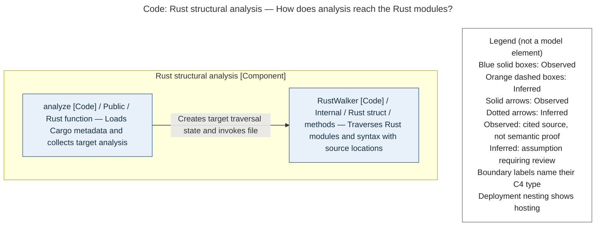

# How does analysis reach the Rust modules?

[All views](README.md) · [Diagram source](code.mmd) · [Evidence](evidence.md)

The analyze function loads Cargo metadata and creates RustWalker state to traverse module files and collect syntax observations.

- Kind: Code
- Scope: Rust structural analysis

## Reading notes

This implementation view is for developers changing source traversal. Follow the call from analyze into RustWalker, then use the cited locations to inspect its state and file handling.

It demonstrates Code notation using a function and a struct. Syntax observations require further interpretation before they become architectural responsibilities.

## Elements

| Name | Kind | Technology | Responsibility | Evidence |
| --- | --- | --- | --- | --- |
| analyze / Public | Code | Rust function | Loads Cargo metadata and collects target analysis | Observed: [src/rust\_analysis.rs:118–262](../../src/rust_analysis.rs#L118-L262) |
| RustWalker / Internal | Code | Rust struct / methods | Traverses Rust modules and syntax with source locations | Observed: [src/rust\_analysis.rs:280–287](../../src/rust_analysis.rs#L280-L287); [src/rust\_analysis.rs:302–371](../../src/rust_analysis.rs#L302-L371) |

## Relationships

| From → To | Interaction | Technology | Evidence |
| --- | --- | --- | --- |
| analyze → RustWalker | Creates target traversal state and invokes file | — | Observed: [src/rust\_analysis.rs:118–262](../../src/rust_analysis.rs#L118-L262) |

Continue reading: [How would a broader system map begin?](landscape.md).
