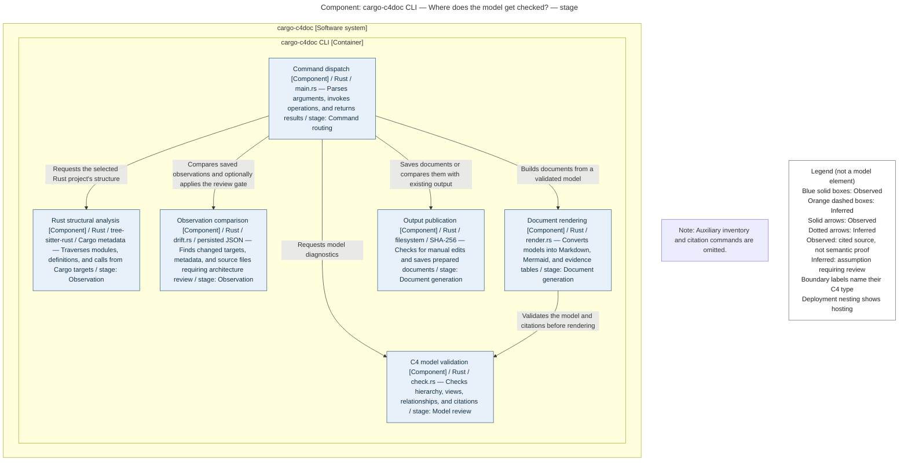

# Where does the model get checked?

[All views](README.md) · [Diagram source](components.mmd) · [Evidence](evidence.md)

Document rendering calls model validation before producing a guide. Command dispatch then hands the prepared documents to publication, which checks for manual edits before saving.

- Kind: Component
- Scope: cargo-c4doc CLI

## Perspective: stage

- **Command routing** — Command dispatch

- **Document generation** — Document rendering, Output publication

- **Model review** — C4 model validation

- **Observation** — Rust structural analysis, Observation comparison

## Reading notes

Follow Command dispatch to Document rendering, then to C4 model validation. Output publication is a separate responsibility: producing a valid guide and replacing an existing directory involve different checks.

For developers changing the workflow, start at src/render.rs for document construction or src/output.rs for publication. The source links below identify the relevant implementations.

Rust analysis and observation comparison are separate commands. Comparison reads saved observations and does not invoke analysis. Auxiliary inventory and citation commands are omitted from this view.

## Elements

| Name | Kind | Technology | Responsibility | Evidence |
| --- | --- | --- | --- | --- |
| Command dispatch | Component | Rust / main.rs | Parses arguments, invokes operations, and returns results | Observed: [src/main.rs:135–281](../../src/main.rs#L135-L281) |
| Rust structural analysis [How does analysis reach the Rust modules?](code.md) | Component | Rust / tree-sitter-rust / Cargo metadata | Traverses modules, definitions, and calls from Cargo targets | Observed: [src/rust\_analysis.rs:118–260](../../src/rust_analysis.rs#L118-L260) |
| Observation comparison | Component | Rust / drift.rs / persisted JSON | Finds changed targets, metadata, and source files requiring architecture review | Observed: [src/drift.rs:353–437](../../src/drift.rs#L353-L437) |
| C4 model validation [Implementation](evidence.md#implementation-validation) | Component | Rust / check.rs | Checks hierarchy, views, relationships, and citations | Observed: [src/check.rs:58–297](../../src/check.rs#L58-L297) |
| Document rendering | Component | Rust / render.rs | Converts models into Markdown, Mermaid, and evidence tables | Observed: [src/render.rs:8–276](../../src/render.rs#L8-L276) |
| Output publication | Component | Rust / filesystem / SHA-256 | Checks for manual edits and saves prepared documents | Observed: [src/output.rs:88–162](../../src/output.rs#L88-L162) |

## Relationships

| From → To | Interaction | Technology | Evidence |
| --- | --- | --- | --- |
| Command dispatch → Rust structural analysis | Requests the selected Rust project's structure | — | Observed: [src/main.rs:137–145](../../src/main.rs#L137-L145) |
| Command dispatch → Observation comparison | Compares saved observations and optionally applies the review gate | — | Observed: [src/main.rs:167–184](../../src/main.rs#L167-L184) |
| Command dispatch → C4 model validation | Requests model diagnostics | — | Observed: [src/main.rs:192–233](../../src/main.rs#L192-L233) |
| Command dispatch → Document rendering | Builds documents from a validated model | — | Observed: [src/main.rs:234–278](../../src/main.rs#L234-L278) |
| Document rendering → C4 model validation | Validates the model and citations before rendering | — | Observed: [src/render.rs:8–21](../../src/render.rs#L8-L21) |
| Command dispatch → Output publication | Saves documents or compares them with existing output | — | Observed: [src/main.rs:269–277](../../src/main.rs#L269-L277) |

Continue reading: [What happens when I render a model?](render_flow.md).
