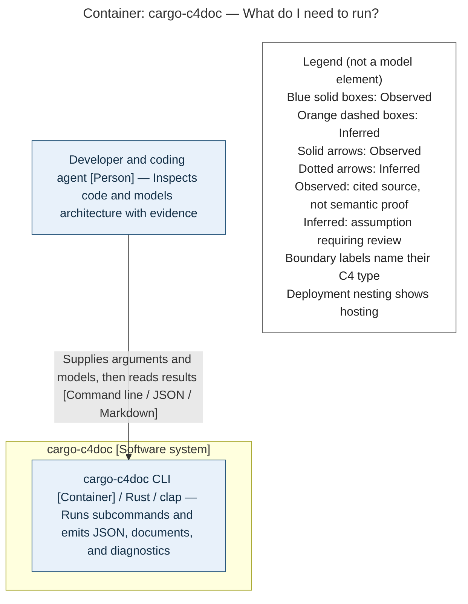

# What do I need to run?

[All views](README.md) · [Diagram source](containers.mmd) · [Evidence](evidence.md)

One Rust executable provides collection, comparison, validation, and rendering. Authors pass commands and models to the CLI and read its JSON or document output.

- Kind: Container
- Scope: cargo-c4doc

## Reading notes

The boundary contains one application. Rust libraries linked into it support its work without creating additional C4 Containers.

This view helps authors understand the tool's runtime shape. The coding agent is represented as an author; its hosting environment and model provider are outside this scope.

## Elements

| Name | Kind | Technology | Responsibility | Evidence |
| --- | --- | --- | --- | --- |
| Developer and coding agent | Person | — | Inspects code and models architecture with evidence | Observed: [src/main.rs:14–25](../../src/main.rs#L14-L25) |
| cargo-c4doc CLI [Where does the model get checked?](components.md) [What happens when I render a model?](render_flow.md) | Container | Rust / clap | Runs subcommands and emits JSON, documents, and diagnostics | Observed: [src/main.rs:135–299](../../src/main.rs#L135-L299) |

## Relationships

| From → To | Interaction | Technology | Evidence |
| --- | --- | --- | --- |
| Developer and coding agent → cargo-c4doc CLI | Supplies arguments and models, then reads results | Command line / JSON / Markdown | Observed: [src/main.rs:135–299](../../src/main.rs#L135-L299) |

Continue reading: [Where does the model get checked?](components.md).
