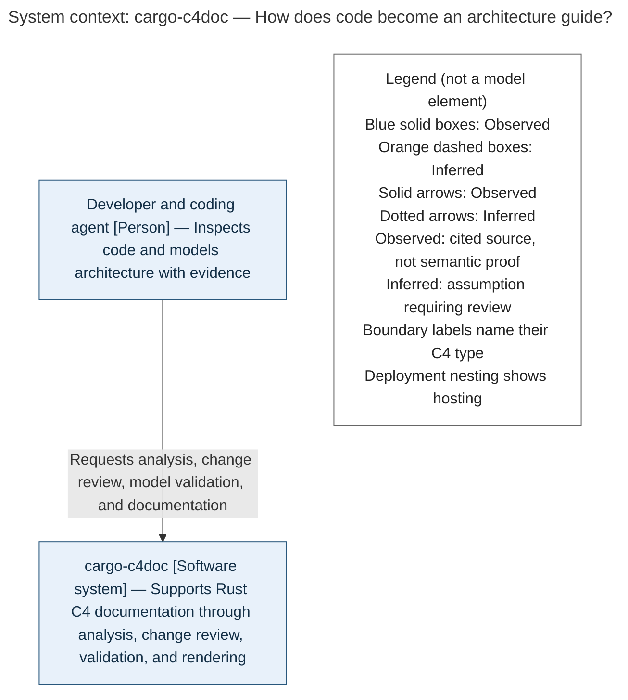

# How does code become an architecture guide?

[All views](README.md) · [Diagram source](context.mmd) · [Evidence](evidence.md)

The author uses cargo-c4doc to collect source observations, check a model, and generate documentation. The coding agent decides what those observations mean for the architecture.

- Kind: System context
- Scope: cargo-c4doc

## Reading notes

Start at the author and follow the request to the tool. The same CLI supports collecting evidence, checking a model, reviewing source changes, and publishing a guide.

This view introduces the workflow to documentation authors. Source-file I/O is outside its scope; the responsibility and interaction views explain the implementation.

## Elements

| Name | Kind | Technology | Responsibility | Evidence |
| --- | --- | --- | --- | --- |
| Developer and coding agent | Person | — | Inspects code and models architecture with evidence | Observed: [src/main.rs:14–25](../../src/main.rs#L14-L25) |
| cargo-c4doc [What do I need to run?](containers.md) [How could a local CLI instance be shown?](deployment.md) | Software system | — | Supports Rust C4 documentation through analysis, change review, validation, and rendering | Observed: [src/main.rs:26–114](../../src/main.rs#L26-L114) |

## Relationships

| From → To | Interaction | Technology | Evidence |
| --- | --- | --- | --- |
| Developer and coding agent → cargo-c4doc | Requests analysis, change review, model validation, and documentation | — | Observed: [src/main.rs:26–114](../../src/main.rs#L26-L114) |

Continue reading: [What do I need to run?](containers.md).
