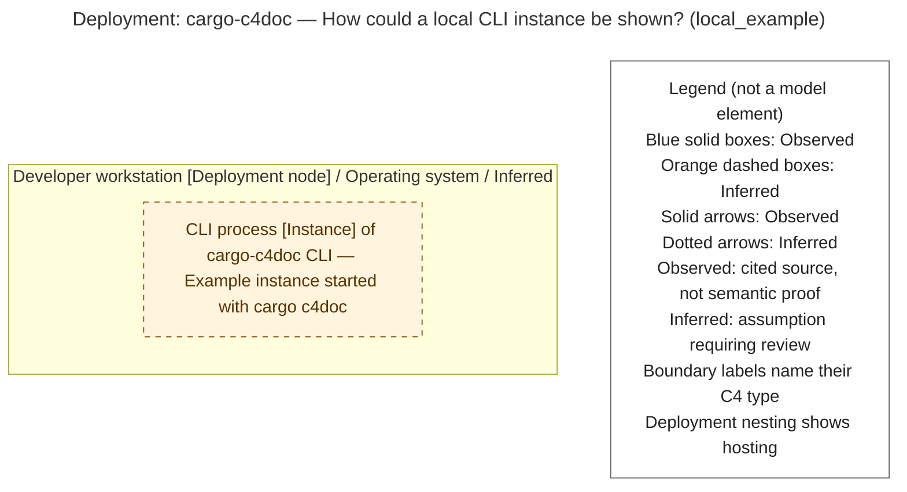

# How could a local CLI instance be shown?

[All views](README.md) · [Diagram source](deployment.mmd) · [Evidence](evidence.md)

This inferred deployment example places one CLI instance on a developer workstation. It illustrates notation and does not document an observed host.

- Kind: Deployment
- Scope: cargo-c4doc
- Environment: local\_example

## Reading notes

For authors learning Deployment notation: the outer node describes the hosting environment, and the nested instance refers back to the CLI Container. The inferred styling keeps this assumption visible.

Replace this example with inspected environment evidence before using it as an account of a real deployment.

## Elements

| Name | Kind | Technology | Responsibility | Evidence |
| --- | --- | --- | --- | --- |
| Developer workstation | Deployment node | Operating system | Example local environment hosting the CLI | **Inferred**: Illustrates local CLI execution; no specific host or production environment was investigated. |
| CLI process | Instance | — | Example instance started with cargo c4doc | **Inferred**: Represents one CLI invocation to demonstrate deployment notation. |
