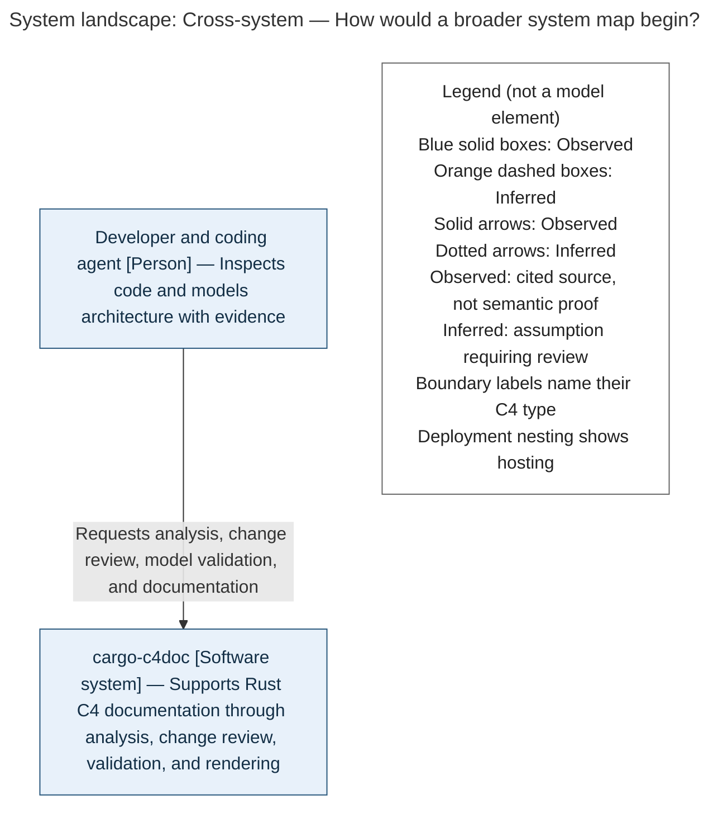

# How would a broader system map begin?

[All views](README.md) · [Diagram source](landscape.mmd) · [Evidence](evidence.md)

This minimal Landscape example contains cargo-c4doc and its author without selecting one system as the scope.

- Kind: System landscape
- Scope: Cross-system

## Reading notes

This additional view is for authors learning the available notation. It has the same elements as Context because this example models only one system; it does not add an invented ecosystem.

In a project guide, add a Landscape view when relationships across multiple systems answer a useful question. It is not a required stop for every reader.

## Elements

| Name | Kind | Technology | Responsibility | Evidence |
| --- | --- | --- | --- | --- |
| Developer and coding agent | Person | — | Inspects code and models architecture with evidence | Observed: [src/main.rs:14–25](../../src/main.rs#L14-L25) |
| cargo-c4doc [How does code become an architecture guide?](context.md) [What do I need to run?](containers.md) [How could a local CLI instance be shown?](deployment.md) | Software system | — | Supports Rust C4 documentation through analysis, change review, validation, and rendering | Observed: [src/main.rs:26–114](../../src/main.rs#L26-L114) |

## Relationships

| From → To | Interaction | Technology | Evidence |
| --- | --- | --- | --- |
| Developer and coding agent → cargo-c4doc | Requests analysis, change review, model validation, and documentation | — | Observed: [src/main.rs:26–114](../../src/main.rs#L26-L114) |

Continue reading: [How could a local CLI instance be shown?](deployment.md).
