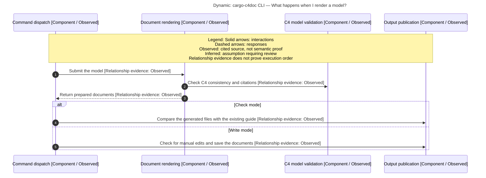

# What happens when I render a model?

[All views](README.md) · [Diagram source](render_flow.mmd) · [Evidence](evidence.md)

After validation, Command dispatch asks Output publication to check the existing guide or save the prepared documents.

- Kind: Dynamic
- Scope: cargo-c4doc CLI

## Reading notes

Follow the model from Command dispatch to Document rendering. The return arrow carries documents prepared in memory; saving happens afterward through Output publication.

Both branches assume validation succeeds. Source links show how the CLI chooses the publication mode. A failed check reports stale output, and an edited file prevents replacement.

## Elements

| Name | Kind | Technology | Responsibility | Evidence |
| --- | --- | --- | --- | --- |
| Command dispatch | Component | Rust / main.rs | Parses arguments, invokes operations, and returns results | Observed: [src/main.rs:135–281](../../src/main.rs#L135-L281) |
| Document rendering | Component | Rust / render.rs | Converts models into Markdown, Mermaid, and evidence tables | Observed: [src/render.rs:8–276](../../src/render.rs#L8-L276) |
| C4 model validation [Implementation](evidence.md#implementation-validation) | Component | Rust / check.rs | Checks hierarchy, views, relationships, and citations | Observed: [src/check.rs:58–297](../../src/check.rs#L58-L297) |
| Output publication | Component | Rust / filesystem / SHA-256 | Checks for manual edits and saves prepared documents | Observed: [src/output.rs:64–138](../../src/output.rs#L64-L138) |

## Scenario

Step order and scenario wording are authored by the agent and require review. Evidence below supports the referenced static interaction; it does not prove execution order.

| Step | From → To | Interaction | Relationship evidence |
| --- | --- | --- | --- |
| 1 | Command dispatch → Document rendering | Submit the model | Observed: [src/main.rs:234–278](../../src/main.rs#L234-L278) |
| 2 | Document rendering → C4 model validation | Check C4 consistency and citations | Observed: [src/render.rs:8–21](../../src/render.rs#L8-L21) |
| 3 | Document rendering → Command dispatch | Return prepared documents | Observed: [src/main.rs:234–278](../../src/main.rs#L234-L278) |
| | | **If** Check mode | |
| 4 | Command dispatch → Output publication | Compare the generated files with the existing guide | Observed: [src/main.rs:269–277](../../src/main.rs#L269-L277) |
| | | **Else** Write mode | |
| 5 | Command dispatch → Output publication | Check for manual edits and save the documents | Observed: [src/main.rs:269–277](../../src/main.rs#L269-L277) |
| | | **End block** | |

Continue reading: [How does analysis reach the Rust modules?](code.md).
